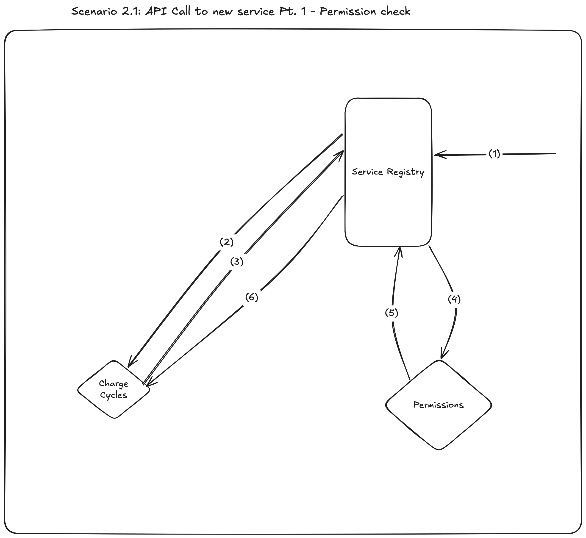
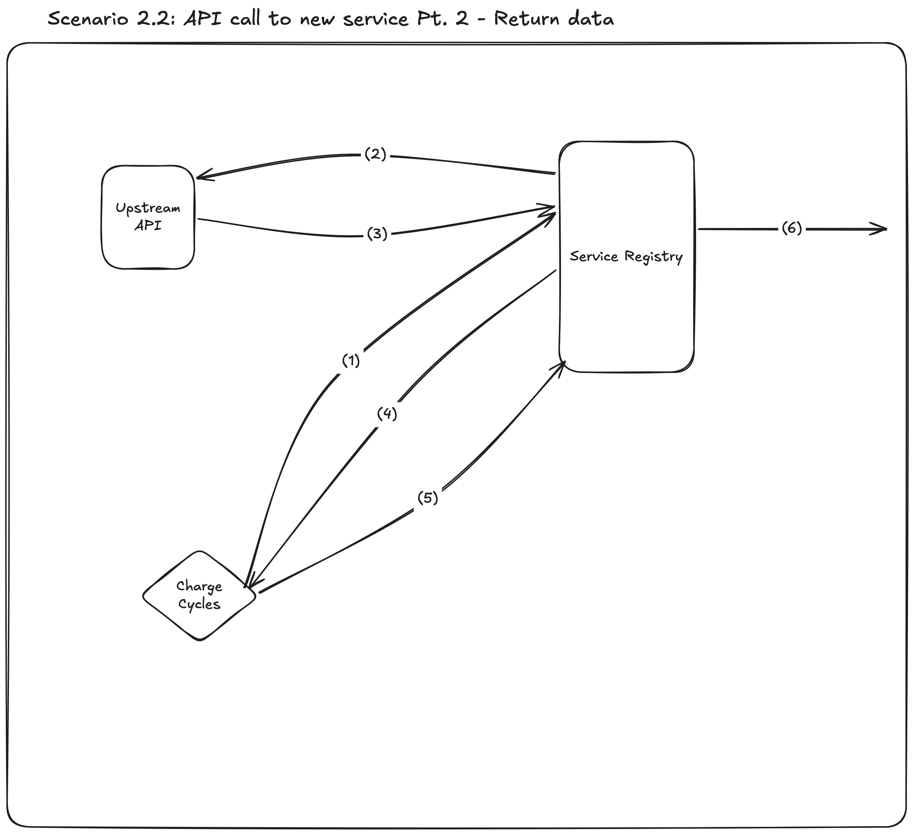

# Design Document

## Assumptions

### 1. End-users access the system & data via a graphical web frontend
- No user will be calling an API endpoint directly via `curl` (or a similar tool) for their day-to-day operations
- Data is displayed to users via a variety of tools in the GUI e.g. dashboards, report generators etc.

### 2. Service discovery is available on the system
- There is already an OTS service registry in place on the system
- The server-side service discover pattern is in place
- All services currently use REST endpoints for communication
- There is an `ANALYTICS` service namespace for the tool that we can register analytics services to
- Downstream tools can query the `ANALYTICS` namespace to discovery what analytics endpoints are available to them
- The provided upstream API is also available on the service registry

### 3. The upstream metering API endpoint is performant and can handle the large amount of read requests we may send to it
- I.E. it is backed by a database on adequate hardware
- Latency for API calls is negligible
- There is no TTL for the data; all data is permanently stored on the database
- If these considerations are untrue, we will have to add additional services to periodically extract data from this
  endpoint and then save it to an analytics DB

### 4. Logged-in users are provided with a cookie for their session
- This is then used in the HTTP header for any API calls that are done on behalf of the user to an internal service
  - This allows us to implement multi-tenancy; a service can check if a user is allowed to access data by sending
    the user's cookie to a `permissions` service

### 5. Services will not attempt to cope with partial degradation of the larger system
- I.E. if a service calls multiple endpoints, and one (or more) endpoints respond with a status of `5xx` and `4xx`,
  then the calling service will propagate the error and return the status code and error message
- There is an assumption that there is replication for services and databases across the system to reduce the 
  actuality of this happening
- All services should log when they respond with an error status code, and we should have monitoring and observability
  tools in place to track whenever a service is degrading.
  - I'm currently assuming that this domain is out of scope for the task, so will not focus on it

### 6. System is running on a Kubernetes cluster

## Design
The plan is to create one service named _Charge Cycles_. This service will expose a number of endpoints that do the
following:
1. Return the number of charge cycles for an asset over a specified period of time
2. Return the warranty information for an asset for a given time period:
    - Total number of cycles completed for that asset of the time period
    - The number of cycles permitted in that time period by the warranty
    - The percentage of the warranty charge cycle limit that has been hit

Below are a few illustrated examples on how the service will behave, as well as how the wider assumed ecosystem
works _(N.B. after drawing these diagrams, I became aware that they would be better suited as sequence diagrams. I
did not redraw them, as I feared that this may have exhausted the given time limit)_:

### 1. Service startup

Upon startup, the service will have to register itself to the registry in order to be discovered by other services.
The sequence of events are as follows:
1. Service sends a registration request to the registry
2. The registry returns a response to the request. If successful, the service is now registered.

The registry has a TTL for a registered service. Once the TTL elapses, the service is automatically de-registered.
Periodically, the service is required to asynchronously send a heartbeat to the registry in order to stop itself
from being registered.
3. Heartbeat request is asynchronously sent
4. Registry responds to heartbeat

### 2. Incoming request to service
When an endpoint on the service is hit, the behaviour can be split into roughly two parts:
1. Validating the request (i.e. checking that the user has the permissions to call this endpoint with the provided
parameter values)
2. Business logic calculation

I've split the explanation up to be between two diagrams.

#### 2.1 Valid permissions first sought

1. Incoming request for an endpoint provided by the service
2. Request is routed to the service
3. Charge cycles service then sends a request to the permissions service (via the service registry)
   - This request includes the asset ID and the user's cookie
4. Request is routed to the permissions service
5. Permissions service responds to service registry
6. Service registry routes response to charge cycles service

#### 2.2 Service calculates result and completes request
This is dependent on the response from the Permissions service in 2.1 responding with success

1. Charge cycles service sends a request to the upstream API via service registry
2. Service registry routes request to upstream API
3. Upstream API responds to request
4. Request routed back to charge cycles service
5. Charge cycles service uses data and responds to request
6. Service registry routes response

### Scaling
To cope with increased demand, each service can theoretically be replicated, with replicas then positioned behind a
load balancer. Additionally, it looks like all of the services mentioned here will be dealing with more read
requests than write requests. We can add caches in front of each load balancer to help deal with the read request
volume.

Assuming the database continues to be performant,
I'd anticipate the permissions service to be the first thing to be overloaded (as many different services will want
to check various aspects of user permissions). So this is likely going to be the first thing we scale up.

## Priorities
Below are a list of details to implement in priority order (i.e. 1 = highest priority thing to do). I would consider
(1) to be the MVP, as any data leakage could cause permanent damage to the company's reputation. (2) is when the
service can begin to become usable to other components, and (3) would include additional functionality to hopefully
improve user experience.

1. Charge cycles service that can return the number of cycles over a given timeframe for an asset. Service only
returns this number if the requesting user has permission to view the asset.
2. Charge cycles service can register itself with the service registry and send heartbeats asynchronously
3. Charge cycles service can also return the number of cycles for an asset in the context of its warranty period

## Additional work to consider in the future
### 1. Compaction job on the database
- Over time, I assume users will care less about the granularity of measurements from the past. E.g. I assume asset
  optimisers wouldn't ever look at the charge cycle data from a particular day that occured 5 years ago. Therefore,
  there is potential to save space on the metering database by compacting this data.
  - E.g. Instead of storing ~2.6x106 data points for every second of a given month, we could aggregate all the data
  across the month and store it as one data point
- An asynchronous compaction job could run periodically to achieve this 
- We'd need to get an idea of what timescales users stop caring about highly granular data before we do this.

### 2. Split the service out into smaller analytics services as it grows/we identify new domains
Currently, I've included endpoints for both charge cycle calculations and warranty-related calculations
in one service as I see them as bound to the same domain.
As the functionaltiy grows, and more business logic is introduced, it could be the case that we identify
two or more separate domains within the code. If that is the case, we should split this service up into
multiple separate services, with one service for each domain.

## Upstream Change Requests
Within the `tickets` directory, you will find the upstream change requests that have I created for both API endpoints
A new version of the API spec is included in this directory (named `upstream-api-docs.yaml`), which contains all
the changes requested in the tickets.