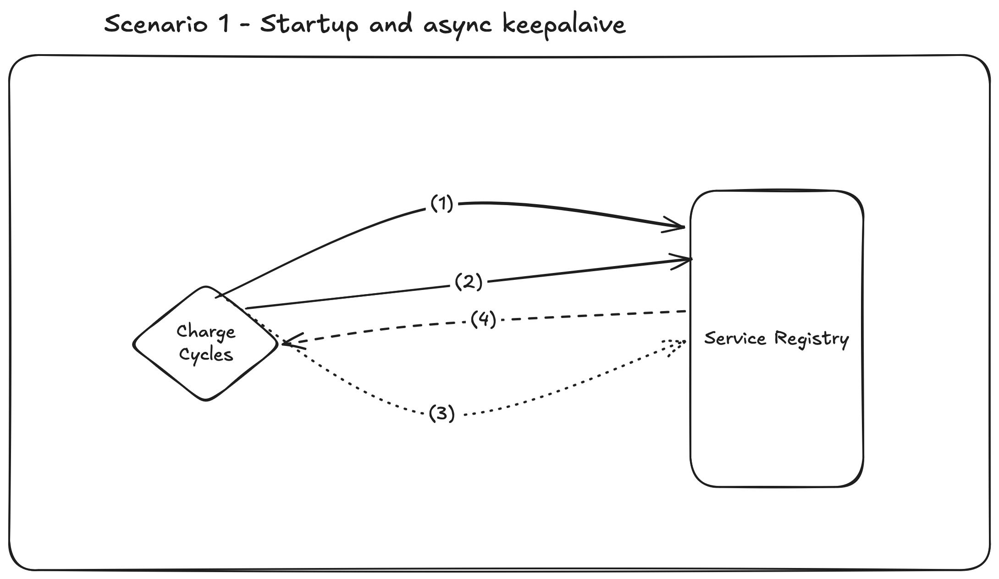

# Take Home Task - Qumarth Jash

## Assumptions

### 1. End-users access the system & data via a graphical web frontend
- No user will be calling an API endpoint directly via `curl` (or a similar tool) for their day-to-day operations
- Data is displayed to users via a variety of tools in the GUI e.g. dashboards, report generators etc.

### 2. Service discovery is available on the system
- There is already an OTS service registry in place on the system
- The server-side service discover pattern is in place
- All services currently use REST endpoints for communication
- There is an `ANALYTICS` service namespace for the tool that we can register analytics services to
- Downstream tools can query the `ANALYTICS` namespace to discovery what analytics endpoints are available to them
- The provided upstream API is also available on the service registry

### 3. The upstream metering API endpoint is performant and can handle the large amount of read requests we may send to it
- I.E. it is backed by a database on adequate hardware
- Latency for API calls is negligible
- There is no TTL for the data; all data is permanently stored on the database
- If these considerations are untrue, we will have to add additional services to periodically extract data from this
  endpoint and then save it to an analytics DB

### 4. Logged-in users are provided with a cookie for their session
- This is then used in the HTTP header for any API calls that are done on behalf of the user to an internal service
  - This allows us to implement multi-tenancy; a service can check if a user is allowed to access data by sending
    the user's cookie to a `permissions` service

### 5. Services will not attempt to cope with partial degradation of the larger system
- I.E. if a service calls multiple endpoints, and one (or more) endpoints respond with a status of `5xx` and `4xx`,
  then the calling service will propagate the error and return the status code and error message
- There is an assumption that there is replication for services and databases across the system to reduce the 
  actuality of this happening
- All services should log when they respond with an error status code, and we should have monitoring and observability
  tools in place to track whenever a service is degrading.
  - I'm currently assuming that this domain is out of scope for the task, so will not focus on it

## Design
The plan is to create one service named _Charge Cycles_. This service will expose a number of endpoints that do the
following:
1. Return the number of charge cycles for an asset over a specified period of time
2. Return the warranty information for an asset for a given time period:
    - Total number of cycles completed for that asset of the time period
    - The number of cycles permitted in that time period by the warranty
    - The percentage of the warranty charge cycle limit that has been hit

Below are a few illustrated examples on how the service will behave, as well as how the wider assumed ecosystem
works _(N.B. after drawing these diagrams, I became aware that they would be better suited as sequence diagrams. I
did not redraw them, as I feared that this may have exhausted the given time limit)_:

### 1. Service startup

Upon startup, the service will have to register itself to the registry in order to be discovered by other services.
The sequence of events are as follows:
1. Service sends a registration request to the registry
2. The registry returns a response to the request. If successful, the service is now registered.

The registry has a TTL for a registered service. Once the TTL elapses, the service is automatically de-registered.
Periodically, the service is required to asynchronously send a heartbeat to the registry in order to

### Scaling

## Priorities
Below are a list of details to implement in priority order (i.e. 1 = highest priority thing to do). I would consider
(2) to be the MVP, as any data leakage could cause permanent damage to the company's reputation.

1. `cycles` service that can return the number of cycles over a given timeframe for an asset
2. `cycles` service 

## Additional work to consider in the future
### 1. Compaction job on the database
- Need to get customer requirements

### 2. Split the service out into smaller analytics services as it grows/we identify new domains